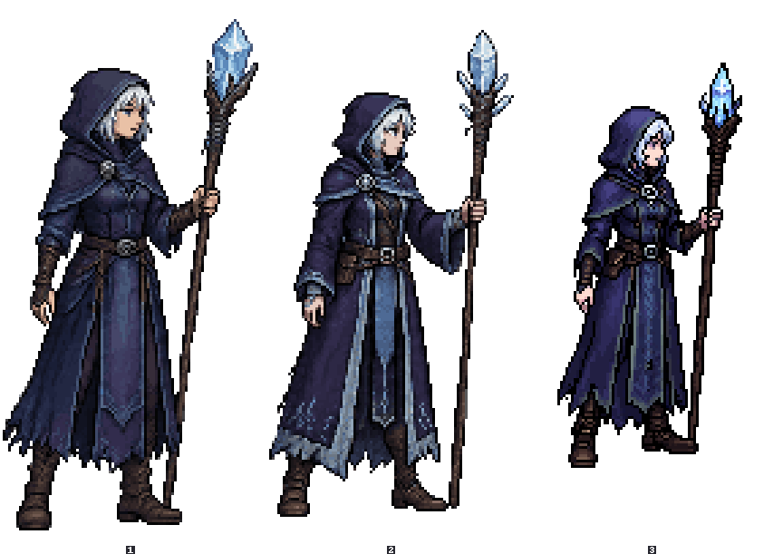
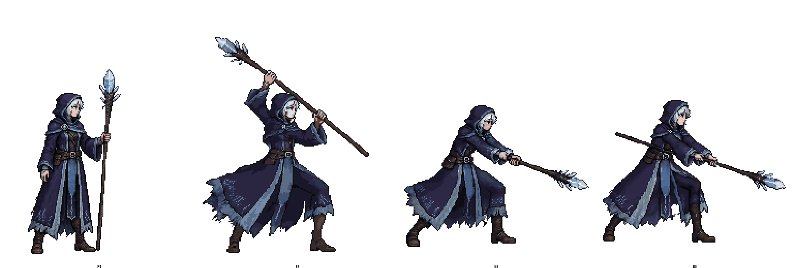
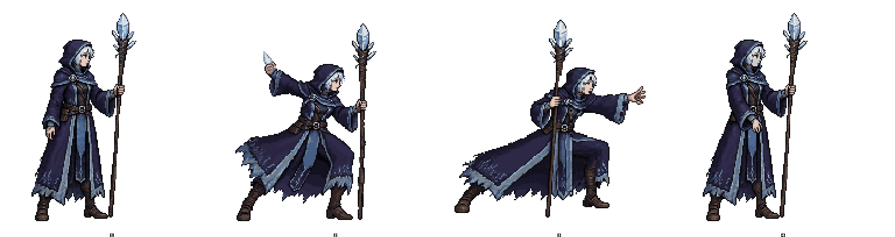
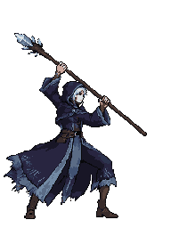
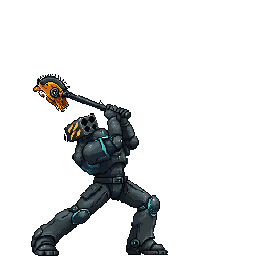
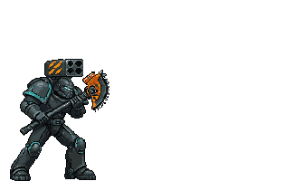
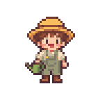

# Clean End-to-End Runs

Historical prototype evidence, recorded before PR #11 remediation. The Studio UI/approval levels described here are no longer shipped. These results do not validate the revised head; see the [current integration record](../README.md).

One headless Claude Code session with only this branch installed: the `pixellab-pip` core and the
`pixellab-pip-studio` edition, loaded as plugins. Nobody answered questions during the run, and the older
`pixellab-game-art` skill was moved out first. The session was told to read only the installed skill.

**Request, as a user would phrase it:** "I'm making a side-view action game. Make me a young frost mage with a
crystal staff, facing right, with two animations: a staff-swing attack and a skill where she throws an ice shard
that bursts on impact. I want game-ready sprite sheets and a showcase GIF."

**Owner stand-ins given to the session:**
- the approval level is `plan`, with a budget of 150 generations and 2 redos;
- when asked for a style, pick the example "Side-view dark fantasy";
- judge the key poses at 3x itself.

## Run 1: Frost Mage (Side-view dark fantasy)

| | |
|---|---|
| Wall time | 28.5 min |
| PixelLab spend | 87 generations: still 18, attack 44, skill 25 (`vfx_workbench` is free) |
| Spend accuracy | every estimate matched the charge; the manifests summed to the balance change exactly |
| Approval behaviour | one plan approval (~69 generations plus redos); content pauses at the candidate pick and the key-pose review; both redos used on one attack pose (canvas-edge cut, then a half-length staff) |
| Doctor verdict | "ready" on both moves; the look checklist passed with the minor problems listed below |

| Candidates | Attack key poses | Skill key poses |
|---|---|---|
|  |  |  |

| Attack | Skill (shard and burst baked in) |
|---|---|
|  |  |

**Run folder per move:** `raw/`, `keys/`, `clean/<n>-<step>/`, `fx/`, `final/`, plus `manifest.json` and a
blueprint. **Delivered:** the sheets with Aseprite JSON, preview GIFs, a body-only skill sheet plus the effect sheet
and shard sprite for engines that spawn projectiles, and a showcase GIF.

### What Worked

- **Style example.** The "Side-view dark fantasy" example gave sizes, padding, frame counts and timing that fit
  together.
- **Cost estimates.** `get_pro_flash_capabilities` and the estimates returned at submit matched the charges.
- **Key poses.** The recipe (prompt template, dynamic layer, screen-side wording, redo rules, 3x look checklist)
  got 4 of 5 poses right first time. The edge rule caught the fifth.
- **Effect.** `vfx_workbench` built the shard's flight, trail and shatter in one call. `bake_fx --anchor/--widen`
  placed it on the body frames.

### Findings and What Changed

| # | Finding | Change on this branch |
|---|---|---|
| 1 | Running a helper twice into the same `--out` replaced `derivative.json`, so the first record was lost | the earlier records are kept under `previous` (test: `test_second_run_into_the_same_out_keeps_the_first_record`) |
| 2 | `fix.py --table` printed the table and exited without checking the frames | with frames given it prints the table, then checks (test: `test_table_with_frames_still_checks_them`) |
| 3 | The budget was counted per run folder, but one plan wrote three folders (still, attack, skill) | `manifest.py committed <run> <run>...` sums them; `auto.md` says to pass every folder of the plan (test: `test_committed_sums_every_run_of_one_plan`) |
| 4 | The showcase GIF always baked a dark background, against the Asset Integrity rule | transparent by default, with `--bg discord` on request (test: `test_showcase_finds_existing_moves`) |
| 5 | The doctor's look list had nothing for a staff changing hands, a one-frame head turn, or a thrown projectile | three items added (test: `test_report_carries_the_look_checklist`) |
| 6 | "The one pause inside an approved plan" contradicted the candidate pick, which also pauses | `plan` names both content pauses |
| 7 | SKILL.md said to omit seeds, while the candidate blueprint sends seeds 1, 2, 3 | candidate batches are named as the third case for sending seeds |
| 8 | The still route needs an anchor sprite that a new project does not have | text only for a new project, then register the pick with `project_style.py anchor` |
| 9 | All three candidates put the staff in the near hand despite the prompt | the note now says to keep the hand the generator drew and name it in every later pose |
| 10 | The upload ticket expired mid-run with a 401; `curl` was blocked in the session | a new URL for each upload; the stdlib HTTP fallback is documented |
| 11 | Clip-mode `scrub` missed a frost flash close to the robe colours; `--clear-right` cut the hand | check its output and finish per frame in pose mode; set `--clear-right` past the fingertips |
| 12 | `despeckle` changed 70-160 pixels per frame on detailed art | check the counts in `derivative.json`, then raise `--tol` or skip it |
| 13 | `bake_fx --anchor` was read as the export's origin field | defined as the projectile's start pixel inside the effect image |
| 14 | Colour-matched keys, joined clips and effect exports had no named folders | Run Folder names `raw/`, `keys/`, `clean/<n>-<step>/`, `fx/`, the still's folder, and the join step |
| 15 | A conjured projectile (not on the still) did not fit the thrown-prop recipe | a step for conjured projectiles was added |
| 16 | `fetch.py --generations` said "charged", while Pro Flash returns an estimate at submit | the help text names what to record |
| 17 | The approval level is saved per skill install, which the command did not say | the reply now says the level applies to every project using the install |

**Left as is:**
- `preview_gif.py` rounds an 83 ms frame to 80 ms (GIF centiseconds) and skips its exactness check over 255
  colours without a warning.
- The `vfx_workbench` `comet_trail_head` layer drew a stray dot; this is PixelLab's tool behaviour, and the run removed the layer.
- The `pga-*` commands are hand-offs to the skill. `pga-init` was not offered when `pixellab.json` was missing.

### Art Problems Left in the Result

- Attack: one frame turns the head away. Frames 6-11 nearly hold the hit pose, handled by timing.
- Skill: one frame turns the face toward the viewer. The staff drifts toward the body's centre line during the
  throw. On the release frame, a faint glint sits at the hand.
- The shard is 11x12 px, small beside a 96x200 hero. `despeckle` slightly flattened the robe-hem runes.

The doctor said "ready" on both moves because its odd-frame check splits the body into a 3x3 grid, which is too
coarse to catch a head turn, and its weapon checks ask only whether the staff is there. Two pixel checks are added, calibrated on 818
shipped, hand-approved animations:

- `head_change` (re-roll level): it finds the reference's head in every frame and flags a frame that matches much worse than both
  neighbours. It flags 1.0% of the shipped set, including a real one-frame face recolour. On this run it flags attack
  frame 5 and skill frame 9.
- `prop_drift` (a warning): a held prop that leaves the span its first and last frames hold it in. It flags 5% of the shipped set
  (swings that cross the body). On this run it flags skill frame 4, where the staff changes hands.

The new look items (finding 5) cover the same faults when the reviewer looks.

## Run 2: Space Marine (Side-view sci-fi)

Same setup, with the run-1 fixes in place. The request was a heavily armoured space marine with a two-handed chain-axe
and a shoulder rocket pod: an overhead chop attack, and a skill that fires the pod's rocket, which explodes on impact.
The style was the "Side-view sci-fi" example, its first real test.

| | |
|---|---|
| Wall time | 28 min |
| PixelLab spend | 73 generations: still 18, attack 39, skill 16 (cap 100) |
| Spend accuracy | the manifests' `committed` total equalled the balance change |
| Doctor | both moves "ready"; no `head_change` or `prop_drift` findings |

| Attack | Skill (rocket and blast baked in) |
|---|---|
|  |  |

**Run-1 fixes seen working:**
- the stdlib upload fallback ran when `curl` was blocked;
- the level reply named the install-wide scope;
- the showcase came out transparent;
- the new run folder layout was used;
- the pose review caught a hit pose drawn 25% too large.

## Run 3: Extras (Top-down cozy, and icons)

Two requests in one session, with a 60-generation cap.
- **Farmer:** a walkable farmer in the "Top-down cozy" example.
- **Icons:** six inventory icons for the run-1 frost mage, from the project style saved there.

| | |
|---|---|
| Wall time | 21 min |
| PixelLab spend | 54 generations: farmer 24 (candidates, rotation, two walks), icons 30 |
| Result | a 4-direction farmer with an 8-frame walk per direction; six 32x32 icons that share the mage's outline and shading |

| Farmer walk (south) | Frost mage icons |
|---|---|
|  |  |

- **Farmer walk:** the template walk dropped the watering can. A v3 walk that names the can kept it in all 32 frames.
- **Icons:** they used a 32x32 crop of the mage's staff crystal as the style reference. That kept the outline and shading
  without copying its colours.

## Findings From Runs 2 and 3, and What Changed

| # | Finding | Change |
|---|---|---|
| 1 | At `plan`, the agent approved its own plan silently: no cost card was shown in either run | the card is posted as visible text even when it is approved at once; at `plan` its header names the budget and redos; SKILL.md lists the card as the one message allowed before the final report (test: `test_plan_level_always_posts_the_cost_card`) |
| 2 | `/pga-level plan 100 2` passed plain numbers; the helper only took `--budget/--retries`; the relative path failed outside the skill folder | the helper takes `level plan 100 2`; the docs use the skill's absolute path (test: `test_plan_budget_and_redos_as_plain_numbers`) |
| 3 | `ground_snap --check` demanded `--out` | `--out` is required only without `--check` (test: `test_ground_snap_check_needs_no_out`) |
| 4 | The doctor offered to drop a frame passed as `--fx` | timing proposals skip effect frames (test: `test_no_drop_proposed_for_an_effect_frame`) |
| 5 | No command recorded a job's outcome, and a character job stayed "submitted" | `manifest.py done` and `manifest.py outcome` (test: `test_outcome_and_done_from_the_command_line`) |
| 6 | Rotation links on PixelLab's file host refused Python's default user agent (403), and no helper downloaded them | `fetch.py --url <link> <out>` for allow-listed PixelLab hosts, with its own user agent (test: `test_url_download_sends_a_user_agent`) |
| 7 | "Side-view sci-fi" had no canvas, frame or timing values; its "no medieval weapons" clashed with a chain-axe | sci-fi carries the tested animation values; a negative that names a requested item is dropped for that call (test: `test_side_view_examples_carry_animation_values`) |
| 8 | Style sizes read as figure sizes | the style examples say sizes are canvases, with the measured figures |
| 9 | No recipe for a walkable top-down character; the template walk drops held props | a "Walkable Top-Down Character" recipe: front-facing still, v3 rotation, v3 walk naming the prop, one animation group |
| 10 | `vfx_workbench` coordinates shift as the canvas refits; the effect-only export has no frame JSON; a second export made a second copy | the workbench page covers coordinates, the game pack's `whole.png`, its frame JSON and placement |
| 11 | Two splice recipes looked contradictory | the page says which problem each one solves |
| 12 | The first hit pose came back 25% larger | the key-pose templates say "exactly the same body size as the original" |
| 13 | A shoulder pod recoils, so the exhaust landed on the helmet | a "Gear-mounted launchers" note: the muzzle point per frame, exhaust after the recoil peak |
| 14 | The `animate_image` cost was guessed | the in-betweens section gives the documented cost formula |

**Tried and dropped:** a doctor check for a missing coloured part (the farmer's can). The can shared its green with
the overalls, and the template walk shifted every colour, so judging by colour could not see the can was gone.
Prevention is the walk recipe (finding 9), and the look checklist covers it.

**Left as is:**
- `make_sheet.py` writes animation timing into an icon sheet's JSON;
- `pga-init` has no default when the user names no engine;
- `history.py` needs `--root` from outside the project.

## New Weapon Pages

From the owner's reference folders, written in our own words with no images, captions or sources copied:
- `weapon-firearms.md`: grips, stances, reload, pump and draw cycles, run-and-gun, top-down;
- `weapon-futuristic.md`: arm cannons, energy blades, glow colours, cyborg limbs;
- `weapon-anime.md`: giant swords, scythes, kunai, chibi exaggeration.

Their prompt wording is drawn from the references and has not been tested on PixelLab yet.

## Not Tested

- The Codex path; the owner skipped this test.
- The `/pga-panel` view during the run: a headless session has no panel.
