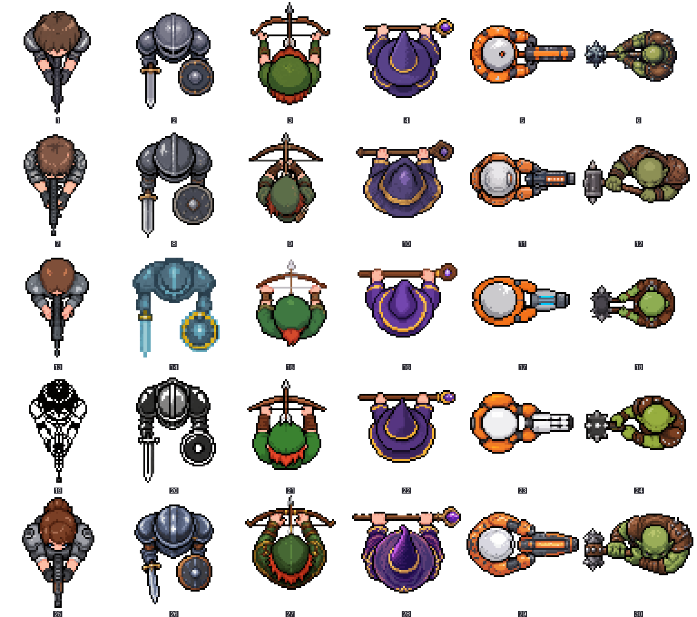

# PixelLab Strict-Overhead Character Prompting Research Spike

Last reviewed: 2026-11-16. Status: **complete**.

- All saved outputs decode as 64x64 PNGs. File integrity does not establish camera,
  anatomy, natural motion, correct gear, or a usable loop.

**Current conclusion:** the workflow is not reliable enough to generate a complete,
production-ready Hotline Miami-style animation set unattended. **Pro Flash text-only
creation followed by raw PixMiniMax animation is the strongest tested path**, but only
one walk is a provisional pass; the best idle, run and shoot remain uncertain. A single
sprite rotated in the game avoids directional asset production, which the user dropped
from scope after the already-submitted exploratory tests.

**Weapon placement is solved for stills.** The original G1 wording made characters hold
weapons centered and across the body, like a gift. A weapon-grip prompt, with one grip per
weapon class, put the weapon at the right side pointing forward in **12/12** fresh-seed
tests of its final wording. See [weapon placement follow-up](#weapon-placement-follow-up).

See [follow-up verification](#follow-up-verification-styles-and-single-direction-animation)
for the broader results. The original Stages 1–10 below remain historical evidence.
Their exact requests retain their original wording; current templates and follow-up
prompts omit the redundant `Pixel art` phrase.

## Practical MVP per route (observed; REST v2, 64x64, `no_background: true`)

Scores are visual-review estimates, with borderline cases counted as failures. They apply
only to the subjects and seeds listed in the stage sections. None of these is a universal
method; verify every output against the [rubric](#strict-overhead-rubric).

| Route | MVP | Final evidence |
|---|---|---|
| **Pro Flash** `create-image-pro-flash` | **G1 geometry-first text**, no reference image. Best tested static starting point, especially outlined/gritty rendering. | The initial eight trials gave six clear camera passes and two uncertain results. Broader follow-up: **17/30 clear camera passes**, 12 uncertain and one failure; only **7/30** passed camera, gear, facing and requested style together. This does not establish general reliability. |
| **Pro** `generate-image-v2` | **R1 native-pixel overhead `style_image`** (`color_palette: false`) plus a geometry or camera prompt (G2 or the Stage 7 wording). Promising for the camera; props need checking. | Camera usually held: gunman, orc 16/16, archer about 15/16, G2 knight 16/16, G2 hoodie about 12/16. Props were often dropped, detached or wrongly oriented, and the long-coat woman failed with the guide. |
| **Pro**, text only | G1 works only for some subjects. | Camera passed on 2/8 G1 calls: hoodie (Stage 9, bat facing wrong) and staff (Stage 10, 16/16, staff crosswise). Neither fully met the prop request. Knight, orc and astronaut stayed frontal or oblique. Prompt E: 2/11 calls. |
| **Pro / Pro Flash edits** (`edit-images-v2` `edit_with_text`, `edit-image-pro-flash` `text`) | Re-skin an existing strict-overhead sprite. | Kept the camera for compact subjects (gunman, knight: 3/3). Long-coat woman 0/3. |
| **Pixen** `create-image-pixen` / `edit-image-pixen` | **No flexible method found.** | 0/8 text, 0/5 edits. |
| **PixFlux** `create-image-pixflux` | **No flexible method found.** | 0/10. Text stayed upright. An init image either copied the source (strength 300+) or lost the subject (100). |

The bundled [text-only MVP blueprint](../../skills/pixellab-pip/blueprints/strict-overhead-character-mvp.blueprint.json) uses the [weapon-grip prompt](#weapon-placement-follow-up), always facing the top edge. It defaults to the tested ninja and exposes subject, head top, shoulder tops, weapon, weapon grip and rendering as variables. The [PixMiniMax animation MVP blueprint](../../skills/pixellab-pip/blueprints/strict-overhead-pixminimax-animation-mvp.blueprint.json) animates that still, defaulting to the tested walk. Defaults reproduce reviewed requests; overrides still require fresh visual verification.

Templates:

These are useful prototypes found within the tested variants, not proven shortest prompts.

```text
Pro Flash armed (current MVP): see the weapon placement follow-up.
Pro Flash G1 (weapon held centered, like a gift): Straight-down floor-plan sprite: a round {head-top} in the center, inside a wider oval of {shoulder-tops}; both arms reach toward the {facing} edge holding a {prop} lying flat, seen lengthwise. Nothing below the shoulders shows. A {subject}.
Pro + R1 style_image (G2): Same straight-down camera and head-inside-shoulders layout as the style image. New character: a {subject} with a {head-top} and {shoulder-tops}, arms reaching toward the {facing} edge with a {prop} lying flat.
Overhead-source edit: Replace the character with {subject} holding {prop} {facing}. Keep the same straight-down overhead camera, crown and shoulder tops, hidden face and torso, and rendering.
```

Write `{head-top}` and `{shoulder-tops}` as the surfaces a downward camera sees:

- `steel helmet dome`, not a visor;
- `red hood top`, not a hood opening;
- `pauldron tops`, not a chest plate.

Visible visors, faces and chest fronts were common signs of failure. The trials do not
isolate their causal effect. These alternatives did not establish a flexible method:

- Pro `reference_images` as a camera source (0/16);
- `generate-with-style-v2` (near-copies the guide);
- named-game or "seen from directly above" wording alone (0 passes).

### Examples

These are research candidates and inspection sheets, not verified production assets. Each
individual character PNG is an unchanged native 64x64 output; the larger inspection sheet
is a transparent, numbered nearest-neighbour preview.

- **G1 on Pro Flash, Stage 10 fresh seeds:**
  - [knight](strict-overhead-character-examples/knight.png)
  - [hoodie](strict-overhead-character-examples/hoodie.png)
  - [orc](strict-overhead-character-examples/orc.png)
  - [staff](strict-overhead-character-examples/staff.png) (camera pass, prop held crosswise)
  - [astronaut](strict-overhead-character-examples/astronaut.png)

  Contact sheet: [inspection sheet](strict-overhead-character-examples/geometry-first-flash-inspection.png)
  (labels 1–5 in the same order). Replay: [blueprint](strict-overhead-character-examples/geometry-first-flash.blueprint.json).
  These are text-only outputs, so no reference attribution applies.
- **Pro with the R1 style guide:**
  [gunman](strict-overhead-character-examples/reference-pro-gunman.png), with its
  [blueprint](strict-overhead-character-examples/reference-pro.blueprint.json) and
  [input](strict-overhead-character-examples/inputs/ghostbyte-pistol-frame1-padded64.png).
  The input was cropped and transparent-padded only.

R1 credit, required for the reference input and any derivative: "Character by
Ghostbyte_dev, CC-BY 3.0, <https://opengameart.org/content/ghostbyte-dev-actionhorror-topdowncharacter-48x48>".
The reference blueprint carries the same attribution.

## Target

- One character on a native **64x64** transparent canvas (`no_background: true`). The
  character is centered, not cropped, and has no text.
- The camera looks straight down at the floor. You see the crown of the head (hair, hat or
  mask top), the tops of the shoulders and the arms in plan. The torso sits under the head
  and shoulders. Legs show only as foot tips or a short walking stride inside the body
  footprint.
- The character faces along the screen plane: up, right or down. Facing is a separate test
  variable, because a facing-down sprite is easy to confuse with a front view (see the
  Stage 1 observations).
- The style should be readable at 64 px with a limited palette. Style is scored only after
  the projection passes.

## Documented route facts (public REST v2, live OpenAPI unchanged from 2026-11-06 cache)

| Route | Projection-relevant controls | Output per call |
|---|---|---|
| `POST /v2/create-image-pixen` | `view` ∈ `side`, `low top-down`, `high top-down` (no overhead/orthographic value); `direction` (8 compass values); `outline`, `detail`, `enhance_prompt` | 1 image |
| `POST /v2/generate-image-v2` (Pro) | prompt; `style_image` + `style_options` (`color_palette`, `outline`, `detail`, `shading` only); up to 4 `reference_images` with `usage_description` (≤500 chars) | 16 candidates (51–64 px band) |
| `POST /v2/create-image-pro-flash` | prompt; `style_image` (must fit inside the output without rescaling) + `style_options`; `seed` is recorded but not deterministic | 1 image |
| `POST /v2/generate-with-style-v2` | `style_images`; output size comes from the style images (a 64x64 guide gives 64x64) | Same count ladder as Pro |
| `POST /v2/edit-image-pixen` | `image` + `description` (≤500 chars) | 1 image |
| `POST /v2/edit-image-pro-flash` | `method` = `text` or `reference` (`reference_image` must fit the source canvas); `no_background` defaults to **false** | 1 image |
| `POST /v2/edit-images-v2` (Pro) | `edit_with_text` / `edit_with_reference`; `no_background` defaults to false | 1 image per input at 64 px |

Implications:

- No route has a 90-degree view control. Pixen's `high top-down` is the nearest selector,
  and earlier spikes found `view`/`direction` to be weak controls.
- Pro and Pro Flash `style_options` copy only palette, outline, detail and shading. Any
  projection a guide passes on is an **implicit** effect of the image, never a selected
  option.
- In PixelLab vocabulary, "top-down" names oblique RPG cameras (low top-down is documented
  at about 20°). Hypothesis: the bare phrase "top-down" pulls output toward the oblique
  front view.

The local experiment record is
`pixellab-pip-generations/strict-overhead-64-research/manifest.json`; its sibling
`stage1-plan.json` through `stage10-plan.json` hold the exact requests, and each test
folder contains a concrete blueprint and only its consumed input copies.

## Prior evidence in this repository

- [Top-down house routing spike](pixellab-top-down-house-generation-routing-spike.md): for
  a building, Pixen and Pro text prompts kept choosing an oblique or isometric projection
  (24/24 Pixen failures). A neutral projection guide used as a style image fixed this.
  The guide was a guide, not an init image.
- [Pixen character prompt spike](pixellab-pixen-character-prompt-research-spike.md): Pixen
  characters drifted toward isometric, three-quarter or portrait framing even at low
  top-down. Framing words changed the outcome more than camera degrees did.
- [Tibia high-oblique spike](pixellab-tibia-high-oblique-perspective-mvp-research-spike.md):
  Pro with an accepted geometry sprite as `style_image` gave the most consistent camera.
  Descriptive reference roles were guidance, not a camera lock.

## Stage 1 results (observed; one call per cell, one subject)

Stage 1 run plan (all 64x64,
`no_background: true`, same seed): three prompts × {Pixen, Pro, Pro Flash}, plus Pixen B
without `view`. Pixen calls used `view: "high top-down"`, `direction: "south"` and
`enhance_prompt: false`. Every prompt asked for a man in a white jacket and blue jeans
**aiming a pistol toward the bottom of the image**.

- **A**: `Hotline Miami style top-down character: …` (named style, bare "top-down").
- **B**: `… viewed straight down from directly overhead, camera 90 degrees above the floor.
  Crown of head, shoulders and arms seen from above; body foreshortened beneath the head.
  Pixel art.`
- **C**: `… viewed straight down from directly overhead. Only crown of head, shoulder tops,
  arms and shoe tips are visible; face, chest and leg fronts are occluded. Hotline Miami
  pixel art.`

| Cell | Observed result | Gate result |
|---|---|---|
| Pixen A, B, C, B-no-view | Front/high-oblique crouching gunman; face, chest and legs fully visible | Fail (front view), all 4 |
| Pro Flash A | Crown dominant, but torso and both legs visible below; reads as high top-down leaning forward | Fail (legs, torso front) |
| Pro Flash B | Crown and shoulders from above, but eyes and nose visible below the hair | Near miss, fail (face) |
| Pro Flash C | Crown seen from above, shoulder band, arms forward, pistol pointing down; strongest result | Provisional pass; may be borderline under the strict camera gates |
| Pro A | 16/16 frontal | Fail, 16/16 |
| Pro B | 16/16 show face and leg fronts (oblique) | Fail, 16/16 |
| Pro C | 16/16 high oblique with long visible legs | Fail, 16/16 |

Pass count: at most 1 of 55 images (Pro Flash C, provisional).

Reading (hypotheses drawn from one subject, not conclusions):

1. Pixen's oblique front-view prior beat every wording tried, including removing `view`.
   Pixen text-only looks like a poor route for this target unless a later
   facing/wording change reverses it.
2. Pro text-only failed 48/48 under all three wordings, including the occlusion wording
   that helped Pro Flash. This matches the house spike: moving up to Pro does not fix
   projection on its own.
3. On Pro Flash, naming what is **occluded** (face, chest, leg fronts) was the change that
   moved the result from a near miss to a provisional pass.
4. "Toward the bottom of the image" asks for a facing-down character, which overlaps with
   the south/front-view prior. Facing up or right, the convention of both reference packs
   below, may pass more easily. Stage 2's no-reference east-facing controls test this.

## Stage 2 (observed)

All 10 calls are 64x64 with `no_background: true` and seed 311029228.

**Reference input.** Every reference call uses the R2 Kenney sprite
`PNG/Hitman 1/hitman1_gun.png` (49x43, faces east), padded to 64x64 without resampling.
The variety call is the exception: it uses `PNG/Man Blue/manBlue_stand.png` (33x43).

**Generation prompt (P2E).** The Stage 1 C wording with the facing changed to east:
`A man in a white jacket and blue jeans aiming a pistol toward the right of the image,
viewed straight down from directly overhead. Only crown of head, shoulder tops, arms and
shoe tips are visible; face, chest and leg fronts are occluded. Hotline Miami pixel art.`

**Reference `usage_description`:** `Use only the straight-down camera, overhead silhouette
and pose; replace clothing and identity as described.`

**Edit instruction (E1):** `Change the character into a brown-haired man wearing a white
jacket and blue jeans, aiming a pistol right. Preserve the exact straight-down camera and
overhead silhouette: crown and shoulder tops visible, face and chest hidden. Crisp pixel
art.`

| Cell | Route and role | Input | Est. gen |
|---|---|---|---|
| ref-pro-style | `generate-image-v2` `style_image` (all `style_options` true) + P2E | hitman1_gun | 10 |
| ref-pro-subject | `generate-image-v2` `reference_images[0]` + P2E | hitman1_gun | 10 |
| ref-pro-with-style | `generate-with-style-v2` `style_images` + P2E | hitman1_gun | 10 |
| ref-flash-style | `create-image-pro-flash` `style_image` (all `style_options` true) + P2E | hitman1_gun | 5 |
| ref-pixen-edit | `edit-image-pixen`, 64x64, E1 | hitman1_gun as the edit target | 1 |
| ref-pro-edit | `edit-images-v2` `edit_with_text`, E1 | hitman1_gun as the edit target | 10 |
| ref-flash-edit | `edit-image-pro-flash` `method: text`, E1 | hitman1_gun as the edit target | 5 |
| ref-pro-variety | `generate-image-v2` `style_image` + P2E with the subject swapped to `A woman in a long teal coat holding a wooden staff toward the right of the image` | manBlue_stand | 10 |
| ref-pro-text-control | `generate-image-v2` P2E, no reference | none | 10 |
| ref-flash-text-control | `create-image-pro-flash` P2E, no reference | none | 5 |

Design notes:

- The two text controls separate the effect of the facing change from the effect of the
  reference.
- With `style_options` all true, the guide's flat Kenney palette and antialiased outline
  are also copied. A later arm should set `color_palette` (and possibly the other options)
  to false if colour or style leaks into the result.
- Edit cells test camera preservation from an already-overhead source. They do not test
  converting a front view to overhead, which remains the harder case.

### Stage 2 results

Method:

- Every returned candidate was classified by the parent's review and by an independent
  second read of the inspection sheets at 4–5x.
- **Upper-body gates** are gates 2, 3, 4 and 6. **Legs** is gate 5.
- **Borderline** means the crown, shoulder plane and arms pass, but shoes or legs extend
  beyond the body footprint toward the bottom of the image. That points to a residual
  south tilt rather than true 90°.
- Where the two reads differ, both are recorded.

| Cell | Images | Classification |
|---|---|---|
| ref-pro-text-control (no ref, P2E facing right) | 16 | Parent: 16/16 read as strict overhead. Second read: 16/16 pass the upper-body gates. Most show shoe tips below the shoulder ring, so gate 5 is borderline. #7 is uncertain: its head is a blank white hood with no crown detail. |
| ref-flash-text-control (no ref, P2E) | 1 | Pass. Hair-whorl crown, shoulder band, foot tips behind the body along the facing axis, pistol right. Best text-only image so far. |
| ref-pro-style (`style_image` hitman1_gun) | 16 | Second read: pass about 7 (#3, 7, 9, 10, 11, 14, 15). Borderline about 7 (#2, 5, 6, 8, 12, 13, 16: walking legs below the body). Fail 2 (#1 and #4: upright or oblique torso with full legs). |
| ref-pro-with-style (`generate-with-style-v2`) | 16 | Overhead-leaning upper body in 16/16. Gate 5 borderline in 16/16: feet hang below the body, and the camera is steeper than the style-image cells. 0 clear strict passes. |
| ref-pro-subject (`reference_images[0]`) | 16 | Fail, 16/16: an upright back view with full legs. |
| ref-pro-variety (style `manBlue_stand`; woman, teal coat, staff) | 16 | Fail, 16/16: an upright back view. The subject, prop and guide all changed at once, so the cause is not isolated. |
| ref-flash-style (`style_image` hitman1_gun) | 1 | Pass on projection. It copied the guide's flat Kenney rendering and grey head strongly (risk of copying identity and style). |
| ref-pixen-edit (E1 on hitman1_gun) | 1 | Fail: the edit re-drew a side-view running man and did not keep the camera. |
| ref-pro-edit (`edit_with_text`, E1) | 1 | Provisional pass: brown crown, white shoulders, pistol right, overhead kept. Check the top-edge margin. |
| ref-flash-edit (`text`, E1) | 1 | Uncertain, leaning fail: the head is a large skin-coloured oval capped by hair, which can read as an upturned face. The response's `images[]` holds the requested result. `original_images[]` is an auxiliary variant, not a second candidate. It looks identical but decodes differently: 281 opaque pixels differ by ≤15 per channel, with identical alpha. The runner now saves only `images[]` as the result. |

Observed effects:

1. **Facing direction was the dominant variable.** The same Stage 1 C wording, with only
   `toward the bottom of the image` changed to `toward the right of the image`, moved:
   - Pro text-only from 0/48 to 16/16 on the upper-body gates;
   - Pro Flash from a provisional pass to a clear pass.
   One subject and one seed, so this is not yet a rate.
2. **Subject-reference mode hurt.** Pro `reference_images` with a strict overhead sprite
   gave 16/16 upright back views, despite a usage description limited to the camera.
3. **A style guide is not needed for Pro when the subject faces right.** It added
   walking-leg variants and copied the guide's style, and gave no clear projection gain
   over the text-only control. On Pro Flash the guide held projection but transferred the
   guide's look.
4. **Edits:**
   - Pixen edit lost the camera.
   - Pro edit kept it.
   - The Pro Flash edit was ambiguous.
   These cells start from an overhead source, so they measure preservation, not repair.
5. **The upright-back failure appeared twice:** subject reference, and the
   staff/standing-guide variety cell. Hypothesis: an empty-handed or vertical-prop
   standing pose invites the back view. Test varied props with text-only prompts before
   blaming the guide.

## Strict-overhead rubric

Score the raw PixelLab output at 3x nearest-neighbour or larger. Check the hard gates first
and stop at the first failure. One reviewer label per image, recorded as `pass`,
`fail:<gate>` or `unsure`.

Hard gates (all must pass):

1. **Integrity.** 64x64 RGBA; one whole character; not touching or cut by the canvas edge;
   transparent background; no text, watermark or second figure.
2. **Crown, not face.** The head reads as the top of the skull: hair whorl, hat top or mask
   top. No eyes, nose, mouth or chin are visible. A mask's top surface is allowed; a mask's
   front face is not.
3. **Shoulder plane.** The shoulders form a band wider than the head, and the head sits
   *on or inside* that band. In a front view the head sits *above* the shoulders.
4. **No torso front.** Visible torso beyond the shoulder band is no more than about half a
   head diameter in the facing direction. No shirt front, belt or buttons stacked
   vertically under the head.
5. **Legs.** Either none visible, or foot tips or a stride that stays near the body
   footprint. Fail full legs hanging down the canvas, kneeling, or a crouch read from the
   front.
6. **Plan-view props and arms.** Arms and any held item lie in the floor plane and read
   lengthwise from above, pointing along the stated facing. Fail a gun seen muzzle-on.
7. **Not another projection.** Not front, back, side, three-quarter, low/high oblique
   top-down or isometric.

Soft scores, recorded only after a pass:

- Facing matches the request.
- Subject adherence (clothing colours, weapon, mask).
- 64 px readability.
- Outline, palette and shading fit.
- With a reference input: how much of the reference's identity was copied (see Known
  limitations).

Advisory metric: for an unarmed silhouette, a bounding-box ratio along the facing axis
above about 1.6 suggests a standing figure was drawn rather than a plan view. A visual
gate decides; this metric never overrides it.

Report each cell three ways:

- calls with at least one pass;
- passing images ÷ returned images.

Pro returns 16 candidates per call, so a per-call pass rate alone would favour it unfairly.

## Overhead reference sources

All sources were retrieved on 2026-11-16 and screened visually at 3–6x nearest-neighbour.
The user authorized internet references. For this spike we chose openly licensed sprites
with clear provenance, so that inputs and derivatives can be shared. This was a research
choice for this spike only, not a general rule.

| ID | Source (public URL) | Author, licence | Native form | Overhead? | Suggested role |
|---|---|---|---|---|---|
| R1 | <https://opengameart.org/content/ghostbyte-dev-actionhorror-topdowncharacter-48x48> → `https://opengameart.org/sites/default/files/ghostbyte_dev_horror-action_topdowncharacter_male.zip` (SHA-256 `45bef81c175fdabd5738dcc7f59dbcabe2a9aff5a4ea825273e1aebc6ff9523d`) | Ghostbyte_dev, **CC-BY 3.0** (credit required), posted 2023-07-28 | True pixel art: 576x48 strips, 12 walk frames of 48x48, 8–10 colours, no partial alpha. Variants: unarmed, arms, pistol, revolver, torch, key, dynamite. | Yes, strict 90°: head oval inside a white shoulder ellipse, arms in plan; faces **up** | The **true pixel-art** secondary guide, the only hard-pixel strict-overhead source found. Use it as a Pro/Pro Flash `style_image` or an edit reference to test whether a pixel-native guide beats R2's antialiased one. Very low detail and red-head/white-shoulder colours, so use `color_palette: false` unless that look is wanted. |
| R2 | Creator page <https://kenney.nl/assets/top-down-shooter> (pack v1.0, 2016; `License.txt` in the ZIP); OpenGameArt mirror <https://opengameart.org/content/topdown-shooter> → `https://opengameart.org/sites/default/files/topdown-shooter.zip` | Kenney Vleugels, **CC0** | Native per-pose PNGs 33–52 x 43 px (e.g. `PNG/Hitman 1/hitman1_gun.png` 49x43, `PNG/Man Blue/manBlue_stand.png` 33x43, `PNG/Soldier 1/soldier1_machine.png`). Flat **vector-style with antialiased edges** (partial alpha), not hard-pixel art. | Yes, strict 90°, soft drop-shadow disc; faces **right** (east) | Stage 2 reference for every role (style, subject, edit target). Later arm: `style_options` false to separate projection from style. |
| R3 | <https://opengameart.org/content/human-topview> (`1245.png`, 469x344, opaque black background) and derivative <https://opengameart.org/content/top-down-man-with-gun-animated> (`sprite-sheet_0.png`, 1326x304) | E-norm (R3a), Technopeasant (R3b), both **CC0** | 3D render, not pixel art; larger than 64 px | Near 90° (slight perspective), two-handed pistol pointing up | Pro `reference_images` only (that route accepts up to 1024 px), usage limited to camera angle. It cannot be a Pro Flash style image without resampling, so it is excluded there. |
| N1 | <https://opengameart.org/node/187293> ("Gunman wearing a cap", `sheet_53.png`), CC0 | bruhfrom2012 | 16x16 pixel art labelled "Top-down" | **No.** JRPG three-quarter | Negative control or example of the wrong projection only |
| N2 | <https://opengameart.org/content/overhead-base-sprite> (`Character Base_1.png`), CC0 | Corey Archer | 112x128 pixel sheet | **No.** Zelda-like three-quarter despite the title | Negative control only |

Screened and rejected:

- <https://opengameart.org/node/59933> ("Gun Guy", CC0): the inspected files are side view.
- <https://opengameart.org/content/top-down-shooter-sprites> (CC-BY 3.0): spaceships, not
  characters.

Third-party "CC0" AI-sprite stores were not used, because their licence and provenance
are unverified. A brief itch.io search for a CC0 hard-pixel overhead character found only
three-quarter RPG bases, or listings with no stated licence. None was adopted.

### Reference preparation (no resampling)

Every consumed input is a single native frame or sprite, copied pixel for pixel and
centered on a transparent 64x64 RGBA canvas. Nothing was scaled or rotated in the paid
experiments. The run records the source archive path and native size.

- Stage 2 used R2 `hitman1_gun` (49x43) and `manBlue_stand` (33x43), padded as shipped
  (facing east).
- Stages 4, 7 and 9 used R1's first pistol or unarmed frame (crop x 0–47, pad 8 px on
  every side). Additional rotated R2 copies were prepared during research but not consumed.

Before uploading, record the R1 credit line in the run manifest: "Character by
Ghostbyte_dev, CC-BY 3.0, OpenGameArt". Before any reference call, also tell the user
which reference images PixelLab will receive.

## Stage 3: prompt minimization (observed)

Stage 3 ran 10 text-only calls. All were
64x64 with `no_background: true`, seed 311029228, aiming right. Each of the three prompts
ran on all three routes:

- Pixen calls used `view: "high top-down"` and `direction: "east"`.
- One extra Pixen E call had no `view` or `direction`.

| Prompt | Text |
|---|---|
| D | `Hotline Miami overhead shooter sprite: a man in a white jacket aiming a pistol right.` |
| E | `Straight-down overhead view of a man in a white jacket aiming a pistol right. Crown of head and shoulder tops visible; face and legs hidden. Pixel art.` |
| F | `A man in a white jacket aiming a pistol right, seen from directly above.` |

| Cell | Images | Classification |
|---|---|---|
| Pixen D, E, F, E-no-view | 4 | Fail, 4/4: three-quarter front-right oblique with face, torso and legs. |
| Pro D | 16 | Fail on the request. 14/16 are back three-quarter oblique, walking with legs. #13 and #14 read as overhead but face **up**, not right (wrong facing). |
| Pro E | 16 | Parent: mostly strict overhead. Second read: 16/16 pass the upper-body gates with feet hidden. About 3 (#2, #9, #16) show a backpack or back surface, a slight tilt, so they are borderline. |
| Pro F | 16 | Fail, 16/16: crown plus the visible back of the jacket. A high oblique seen from behind, not plan view. |
| Pro Flash D | 1 | Fail: face visible, long legs. |
| Pro Flash E | 1 | Pass: grey crown, shoulder ring, feet hidden, pistol right. |
| Pro Flash F | 1 | Fail: face visible, legs. |

Observed effects:

- "Seen from directly above" alone (F) and a named game style (D) were **not enough** on
  any route.
- The **occlusion sentence** (E: `Crown of head and shoulder tops visible; face and legs
  hidden.`) is what turned Pro and Pro Flash into passes. It replaced P2E's longer wording
  with no loss seen.

## Stage 3 per-tool snapshot (one subject, one seed, facing right; superseded by Stage 5)

Template (E, 26 words with the test subject):

```text
Straight-down overhead view of {subject} {action} {facing}. Crown of head and shoulder tops visible; face and legs hidden. Pixel art.
```

| Tool (REST v2, 64x64, `no_background: true`) | Status | Evidence so far |
|---|---|---|
| Pro `generate-image-v2`, text only | E passed this sheet | 16/16 upper-body passes (about 3 borderline). Did not generalize (Stage 5). |
| Pro Flash `create-image-pro-flash`, text only | E passed this image | 1/1 pass. P2E also passed 1/1. Partial generalization (Stage 5). |
| Pixen `create-image-pixen` | **No working prompt found** | 0/8 text-only calls across prompts A–F; `view` `high top-down` or omitted; `direction` `south`, `east` or omitted; facing down or right. Every output was oblique. |
| Pro with `reference_images` (subject role) | Not recommended | 0/16 (upright back view). |
| Pro and Pro Flash `style_image`, and `generate-with-style-v2`, with R1 | Works for the gunman (33/33 images across the three cells) | Copies R1's silhouette strongly; low variety. The woman/staff subject was tested only with the R2 guide (0/16). |
| `edit-images-v2` / `edit-image-pro-flash` text edit of an overhead source | Works for gunman and knight (3/3; the Pro Flash Stage 2 edit was uncertain) | Failed the woman/staff subject (0/2). |
| `edit-image-pixen` text edit of an overhead source | Lost camera (0/2) | Side view, then front view. |

The scope is still narrow:

This snapshot was later tested with fresh seeds and varied subjects (Stage 5).

## Stage 4: R1 pixel guide, varied-subject edits (observed)

Stage 4 ran 10 calls. Inputs:

- Frames of R1 (Ghostbyte), padded to 64x64 without resampling.
- R2 `hitman1_gun`.
- For the camera repair: the first candidate of Stage 2's ref-pro-variety, with R1 as the
  reference.

Exact requests are in the run folder's `stage4-plan.json`.

Shared texts:

- **Guide prompt (G-up):** `A man in a white jacket and blue jeans aiming a pistol up, seen
  from directly overhead. Only the crown of the head, shoulder tops, arms and pistol are
  visible; face, chest and legs are hidden beneath the head and shoulders. Pixel art.`
- **Style `usage_description`:** `Match the straight-down overhead camera and pixel
  rendering; use the requested new character.`
- **Knight edit (K):** `Replace the character with a broad knight in dark steel armor
  holding a sword up. Keep the same straight-down overhead camera, crown and shoulder
  tops, hidden face and torso, and crisp pixel style.`
- **Woman wording (W):** `A woman in a long teal coat holding a wooden staff right`,
  followed by the same occlusion or keep-camera clauses.

| Cell | Route, input role | Images | Classification |
|---|---|---|---|
| pixelguide-pro | `generate-image-v2`, R1 pistol `style_image` (`color_palette` false), G-up | 16 | Pass, 16/16: crown inside the shoulder ellipse, pistol up. Foot tips behind the body on some, along the facing axis. Strong R1 silhouette transfer. |
| pixelguide-pro-with-style | `generate-with-style-v2`, R1 pistol, G-up | 16 | Pass on projection, 16/16. Near-template copies of R1's oval head and shoulder ellipse; mostly only hair or hat colour varies. Low design variety. |
| pixelguide-flash | `create-image-pro-flash`, R1 pistol `style_image`, G-up | 1 | Pass, R1-like silhouette. |
| pixelguide-pixen-knight | `edit-image-pixen`, R1 unarmed as edit target, K | 1 | Fail: front-view standing knight. |
| pixelguide-pro-knight | `edit-images-v2` `edit_with_text`, R1 unarmed, K | 1 | Pass: helmet top, wide pauldrons, sword up. |
| pixelguide-flash-knight | `edit-image-pro-flash` `text`, R1 unarmed, K | 1 | Pass: helmet crest from above, pauldrons, sword up-right. |
| guide-no-style-traits | `generate-image-v2`, R2 hitman `style_image` with every `style_options` false, W + occlusion | 16 | Fail, 16/16: upright rear view, staff held vertical. |
| guide-pro-woman-edit | `edit-images-v2` text, R2 hitman as edit target, W + keep-camera | 1 | Fail: upright rear view. |
| guide-flash-woman-edit | `edit-image-pro-flash` text, R2 hitman, W + keep-camera | 1 | Fail, leaning: hair-covered back and torso below the head; staff right. |
| guide-pro-camera-repair | `edit-images-v2` `edit_with_reference`, failed woman source + R1 reference | 1 | Parent: fail (upright/oblique or wrong facing). Second read: borderline. The hood top and round cloak suggest near-overhead, but the cloak hem extends below the head and the staff is vertical. Not accepted. |

Observed effects:

1. **An overhead pixel guide reliably holds projection for the gunman** on Pro, Pro Flash
   and `generate-with-style-v2`. It does not make the result generalize to new subjects:
   - `generate-with-style-v2` almost re-skinned R1;
   - Pro kept R1's silhouette while varying only details.
2. **Editing an overhead source works for a compact armoured subject** on Pro and Pro
   Flash (knight 2/2). Pixen edits lost the camera both times (0/2).
3. **The long-coat woman with a staff failed everywhere:** text plus guide, guide with
   every style option off, edits on both routes, and a reference repair. Together with
   Stage 2 ref-pro-variety, that is 0/50 images across 6 calls.

   Untested hypothesis: a full-length garment and a vertical staff push the model toward a
   standing rear view, whatever the camera wording or guide. Test it by changing one factor at a
   time:
   - staff pointing along the facing, versus vertical;
   - short jacket versus long coat;
   - woman versus man.

## Stage 5: fresh-seed validation of prompt E (observed)

Stage 5 ran 10 calls: prompt E on Pro
and Pro Flash, one fresh seed per subject. Exact requests are in `stage5-plan.json`.

| Subject (action, facing) | Pro (16 per sheet) | Pro Flash (1) |
|---|---|---|
| Man, white jacket, pistol, right (repeat of Stage 3, new seed) | Fail, 16/16: rear three-quarter, jacket back visible | Pass: crown, shoulders, pistol right |
| Woman, red hoodie, baseball bat, left | Fail, 16/16: frontal, face under hood, bat low | Fail: back of head and hood, bat up-left (oblique, wrong facing) |
| Firefighter, yellow helmet, axe, up | Fail, 16/16: high front oblique with body and boots; #8, #14 and #16 rear | Provisional pass: helmet top, shoulders, axe up |
| Broad knight, dark armour, sword, right | Fail, 16/16: frontal visor, chest and belt | Fail: frontal |
| Scientist, white lab coat, clipboard, facing down | **Pass, 16/16:** crown, shoulder band, clipboard in plan below, face hidden | Borderline: crown and clipboard, but a dark face area shows under the hair |

Observed effects:

- **Pro succeeded on 2 of 6 sheets** with prompt E: the Stage 3 gunman and the Stage 5
  scientist. That is 32/96 images. Each prompt E sheet was nearly uniform, so 16
  candidates did not act as 16 independent tries.
- **Pro Flash passed 3 of 6 images**, with one more borderline: the gunman twice and the
  firefighter.
- **Repeating the Stage 3 gunman with a new seed failed on Pro.** The Stage 3 result was
  seed-dependent, not a stable prompt property.
- **Facing down is not inherently fatal.** The facing-down scientist passed 16/16 on Pro,
  so the earlier facing-down failures were not caused by facing alone.
- **Subjects with strong front-view iconography failed** on both routes: a hood, a visored
  helmet, a front-facing body.

## Stage 6: fresh-seed validation of prompt E, round 2 (observed)

Stage 6 ran 10 calls: prompt E on Pro
and Pro Flash with a new seed per subject. Exact requests are in `stage6-plan.json`.

| Subject (action, facing) | Pro (16 per sheet) | Pro Flash (1) |
|---|---|---|
| Man, white jacket, pistol, right (third seed) | Fail, 16/16: rear three-quarter, jacket back and legs | Pass: crown, shoulders, pistol right |
| Bulky green orc, leather armour, hammer, left | Fail, 16/16: head bowed over a frontal chest, belt and legs | Fail: chest straps and belt visible |
| Woman astronaut, round helmet, wrench, up | Fail, 16/16: upright back view, full body | Fail: front visor |
| Chef, white toque, apron, empty-handed, down | Fail, 16/16: toque top over a frontal apron and legs | Fail: standing body |
| Slender orange robot, arm cannon, right | Fail, 16/16: three-quarter side view | Parent: fail (front armour). Second read: borderline (dome and shoulder pods from above) |

Prompt E totals across Stages 3, 5 and 6 (visual-review estimates, borderline counted as
fail):

- **Pro:** 2 of 11 sheets passed (the Stage 3 gunman and the Stage 5 scientist).
- **Pro Flash:** 4 of 11 images passed (the gunman on three seeds, plus the firefighter),
  with 2 more borderline.

## Stage 7: R1 guide on new subjects, and minimal source edits (observed)

Stage 7 ran 10 calls. Exact requests are
in `stage7-plan.json`.

The guided cells used R1 pistol frame 1 as `style_image`, with `style_options` `{color_palette: false, outline/detail/shading: true}`, `usage_description`
`Straight-down overhead camera and native pixel scale only; replace character, clothes and
held item.` and the prompt
`{subject} holding {prop}, pointing toward the top of the image. Match the reference's
straight-down overhead camera: crown centered between shoulder tops, body hidden
underneath, arms and held item seen lengthwise from above. Pixel art.`

| Cell | Images | Classification |
|---|---|---|
| Pro, woman in long teal coat, wooden staff | 16 | Fail, 16/16: an upright back view with the coat skirt below the head. #4 and #12 are an ambiguous hood blob, counted as fail. |
| Pro Flash, same woman | 1 | Borderline: the camera is overhead, but a large coat mass extends below the head. |
| Pro, red-haired archer, green leather, bow | 16 | Camera passes on about 15/16; #15 is borderline (cloak back). **The subject fails:** the bow is missing or only an edge-on line in nearly all of them. |
| Pro Flash, same archer | 1 | Pass: crown, shoulders, bow drawn across the top, quiver. |
| Pro, bulky green orc, leather armour, mace | 16 | Pass, 16/16: a miniature overhead orc, mace up. Small figure. |
| Pro Flash, same orc | 1 | Pass. Tusks show at the head edge, but no face front. |
| Pro `edit-images-v2` text: R1 gunman → woman with teal coat and staff | 1 | Fail (conservative): hair-covered back with coat bulging below the head. Small figure. |
| Pixen `edit-image-pixen` on R1 unarmed (minimal text) | 3 | Fail, 3/3. `Change the shirt to teal.` gave a hooded coat object. `Replace with a knight in dark steel armor.` gave a full-body front knight. `Change the shirt to red and hair to black.` gave a front portrait. |

## Stage 8: PixFlux text and init-image controls (observed)

Stage 8 ran 10 `create-image-pixflux` calls,
64x64 with seed 311029228. Exact requests are in `stage8-plan.json`.

| Cell | Classification |
|---|---|
| Gunman E, `view: high top-down` + `direction: east` | Fail: upright front/side |
| Gunman E, `text_guidance_scale: 16` | Fail: upright front |
| Orc geometry prompt, `view` + `direction: north` | Fail: upright front |
| Orc geometry prompt, `text_guidance_scale: 16` | Fail: upright front |
| Orc, R1 `init_image`, strength 100 | Fail: the overhead layout survives, but it is the wrong character and the mace is missing |
| Orc, R1 init 300 / 700 / 300 + guidance 16 | Fail: near-copies of R1 (red hair, white body, pistol); a source copy is not counted as a pass |
| Orc, Kenney init 300 / 700 | Fail: near-copies of the bald Kenney gunman with minor colour changes |

PixFlux produced no usable flexible result. With an init image, either the subject was not
changed, or the camera was lost along with the subject.

## Stage 9: geometry-first prompts G1 and G2 (observed)

Stage 9 ran 10 calls, all with the original seed 311029228,
64x64 and `no_background: true`. It covered the three subjects that failed prompt E:
knight with sword (right), woman in a red hoodie with a bat (left), and orc with a hammer
(left).

The prompts were derived from the earlier failures:

- **G1, text only:** describe the plan-view silhouette first, translating each identity
  detail into the surface a downward camera sees.
- **G2:** the same idea paired with R1 as `style_image`, with `color_palette: false` and
  usage `Use the straight-down camera and head-inside-shoulders geometry; change subject,
  colors and prop.`

Exact instantiation (knight shown; the hoodie and orc swap the bracketed values):

```text
G1: Straight-down floor-plan sprite: a round [steel helmet dome] in the center, inside a wider oval of [dark steel pauldron tops]; both arms reach toward the [right] edge holding a [sword] lying flat, seen lengthwise. Nothing below the shoulders shows. A [knight in dark steel armor]. Pixel art.
G2: Same straight-down camera and head-inside-shoulders layout as the style image. New character: a [knight in dark steel armor] with a [steel helmet dome] and [dark steel pauldron tops], arms reaching toward the [right] edge with a [sword] lying flat.
```

Values used:

- Hoodie: `round red hood top`, `red hoodie shoulders`, `baseball bat`, left.
- Orc: `round bald green scalp`, `brown leather shoulder tops`, `hammer`, left.

| Cell | Pro (16 per sheet) | Pro Flash (1) |
|---|---|---|
| G1 knight | Fail, 16/16: helmet visor seen from the front over the torso; sword lying horizontally below (high front oblique) | Pass: helmet dome inside a pauldron ring, sword right, arms in plan |
| G1 hoodie | Camera passes on 16/16 (hood top inside a shoulder ring, no face). **Facing fails:** the bat lies flat below the body with its barrel pointing right, not left. 0 full passes | Pass: hood top, shoulders, bat left, hands from above |
| G1 orc | Borderline, 16/16: the scalp sits at the top edge of the shoulder mass rather than inside it (slight tilt). The hammer correctly points left. 0 full passes (conservative) | Pass (provisional): green scalp inside leather shoulders, hammer left. Ears visible, no face front |
| G2 knight | Camera passes on 16/16 (R1-like helmet top in a shoulder ellipse). **Prop fails:** no sword on 6, a sword floating detached below the body on 5, a sword held vertical (wrong facing) on 5. 0 full passes | Pass: helmet top, sword right; R1-like compact silhouette |
| G2 hoodie | Camera passes on about 12/16 (R1-like hood top in an ellipse). A face shows in the hood opening on #4, #7, #10 and #13. The bat is missing or a stub on about 6, and lies below the body pointing right on the rest. 0 full passes | Borderline: the dark hood opening is visible, a view into the hood, and the bat arm is thin |

Observed effects:

1. **G1 on Pro Flash was a clear pass on the knight and hoodie** and a provisional pass on
   the orc (it needs strict review). All three had failed prompt E. This is the strongest flexible text-only result, but it is one seed per subject.
2. **On Pro, G1 moved the hoodie and orc into near-plan view** (0/32 before), but held props
   did not follow the requested facing. The knight stayed frontal.
3. **G2 (with the R1 guide) reliably carried the camera on Pro**, but the props were
   dropped, detached or wrongly oriented. On Pro Flash, G2 passed the knight and was
   borderline on the hoodie.


## Stage 10: fresh-seed G1 validation (observed)

Stage 10 ran 10 calls: G1 on Pro and
Pro Flash, no reference, one fresh seed per subject. Exact requests are in
`stage10-plan.json`.

Instantiations, with the knight, hoodie and orc as in Stage 9:

- **Staff woman:** `round brown hair crown`, `teal coat shoulder tops`, `wooden staff`,
  `top`; subject `A woman in a long teal coat`.
- **Astronaut:** `round white helmet dome`, `orange spacesuit shoulder tops`, `wrench`,
  `bottom`; subject `A woman astronaut in an orange spacesuit`.

| Subject (seed) | Pro (16 per sheet) | Pro Flash (1) |
|---|---|---|
| Knight (983323901) | Fail, 16/16: helmet visor front, body below, sword horizontal under it | Pass: helmet dome in a pauldron ring, sword right |
| Hoodie (53741105) | Fail, 16/16: face under the hood, frontal torso | Pass: hood top, bat left |
| Orc (983708321) | Fail, 16/16 (conservative): bowed head over a visible chest, hammer below | Pass: scalp inside a leather shoulder ring, hammer left |
| Long-coat woman, staff (8671389) | **Camera pass, 16/16:** crown inside a shoulder ring. **Prop fail:** staff held crosswise above the head, not aimed up | Camera pass; same prop fail (crosswise) |
| Astronaut (588047029) | Fail, 16/16: helmet visor front, body below | Camera pass by parent review. Second read: borderline (possible face/visor rim). Wrench toward the bottom matches the request |

Observed effects:

- **G1 is the first approach to pass the camera gate for the long-coat woman** (both
  routes; 0/50 earlier). The staff was held crosswise rather than aimed up, so prop
  adherence failed. Scored separately from the camera.
- **On Pro Flash, G1 repeated with fresh seeds** for the knight, hoodie and orc.
- **On Pro, G1 did not generalize.** Subjects with a strong front feature (visor, face,
  chest) stayed frontal.

## Controls that may affect projection

- **Prompt.** Camera vocabulary ("top-down" vs "directly overhead/above" vs "90 degrees");
  occlusion wording; facing direction; word order (camera first vs subject first);
  named-game label; "pixel art" or "sprite" framing; the prop's pointing direction.
- **Pixen fields.** `view` (`high top-down` or omitted), `direction`, `outline`/`detail`,
  `enhance_prompt` (may rewrite the camera words; kept off).
- **Pro and Pro Flash fields.** The style image itself, which can carry projection
  implicitly. `style_options` decide what is copied but have no projection switch.
  Reference `usage_description` wording. The 16-candidate batch at 64 px (Pro).
- **Canvas.** A fixed 64x64 square. A facing-right subject with a long weapon may crowd
  the right edge; the integrity gate catches this.
- **Background.** `no_background` defaults differ by route (false on edit routes).
  Background removal does not change projection.

## Known limitations

- Samples are small: at most 11 calls per route and prompt family, and at most two seeds per
  G1 subject. Pro candidates within a sheet are not independent, so per-image rates
  overstate reliability.
- Pro Flash and Pro seeds are not deterministic. Repeats measure variety, not
  reproducibility.
- A guide can pull output toward its own silhouette, colours and identity, as observed in
  the house spike. R1's simplicity (oval head, white shoulders) may flatten detail. Score
  how much reference identity is copied separately.
- R1 is CC-BY: credit is needed for any shipped derivative. R2 is antialiased, not
  hard-pixel art, and may soften outlines if `outline`/`detail` are copied.
- Facing was not tested on its own after Stage 2. G1 passes cover right, left, up and down
  on different subjects, not every facing per subject. Diagonal facings and animation were
  not tested.
- Results apply to the listed REST v2 routes at 64x64 on the review date. They say nothing
  about MCP variants, other sizes, animation or managed characters, which were not tested.

Sources consulted:

- PixelLab REST v2 OpenAPI (`https://api.pixellab.ai/v2/openapi.json`)
- the OpenGameArt and Kenney pages listed above
- the linked repository spikes


## Follow-up verification: styles and single-direction animation

### Scope and method

The follow-up removed `Pixel art` from new prompts, tested 30 text-only Pro Flash stills,
completed ten already-submitted directional comparisons, and tested idle, walk, run and
shoot through four paths. Once the user clarified that the game rotates one sprite,
**no further directional research was submitted**. One later anchored character import
was required only to test managed Skeleton v3 with a mannequin rig; only its south view
was animated. No template/preset animation was substituted for custom Skeleton v3.

Every animation used the same overhead gunman. Its source was a PixelLab text-only
output, turned 90 degrees clockwise by lossless pixel permutation to point down-screen.
This was input preparation, not a locally synthesized animation. Stills need no guide;
**animation needs its chosen starting sprite**. The winning raw PixMiniMax path needs no
Character Creator or 3D rig.

All attempts were retained. Independent agent reviews inspected every frame at enlarged
nearest-neighbour scale and measured size, alpha, connected pieces, visible-pixel changes,
centre drift, input echoes and loop seams. GIFs were decoded and verified against their
PNG sequences. **Agent reviewers did not directly watch live GIF playback**; subjective
naturalness and the provisional verdicts need human playback review before production.
API completion, unique hashes and GIF encoding correctness were never treated as proof
of good motion.

The portable [per-attempt validation record](strict-overhead-character-examples/follow-up-validation.json)
contains all 30 still reviews, ten rotation reviews and 38 animation reviews. The committed
[animation GIF index](strict-overhead-character-examples/animation-gifs/README.md) links **every GIF**. Its model/path folders are flat:
`v3` (11 GIFs), `pixminimax` (11), `skeleton-v3-raw` (8), and
`skeleton-v3-character-creator` (8). Files are named by motion and attempt, such as
`walk-02.gif` or `shoot-05.gif`. The PNGs, exact requests, and blueprints remain
in the original per-call folders.

### Broader still-image verification

The six subjects were a tactical rifle gunner, sword-and-shield knight, archer, pointed-hat
wizard, combat robot and hammer-wielding orc. Each was tested in baseline, gritty outlined,
flat/lineless, one-bit and detailed rendering. All calls were native 64x64, transparent,
text-only, with a recorded fresh seed. Style descriptions were appended to G1. This is a
fixed exploratory matrix, not a random sample of every possible character or style.



Labels 1–30 follow row-major order: columns gunner, knight, archer, wizard, robot, orc;
rows baseline, gritty, flat, one-bit, detailed. Uncertain results are not counted as passes.

| Rendering | Clear overhead camera | Requested rendering | All requirements |
|---|---:|---:|---:|
| Baseline | 2/6 | N/A | 1/6 |
| Gritty outlined | 5/6 | 5/6 | 4/6 |
| Flat/lineless | 4/6 | 0/6 | 0/6 |
| One-bit | 4/6 | 1/6 | 0/6 |
| Detailed | 2/6 | 6/6 | 2/6 |

Totals: camera 17/30; subject/weapon 27/30; facing 29/30; style 12/24 non-baseline;
full pass 7/30. Camera passes by subject: archer 5/5, robot 4/5, orc 4/5, knight 3/5,
wizard 1/5, gunner 0/5. Bare-haired humans often exposed a skin/face strip; pointed hats
were often drawn as side-facing triangles. One-bit text usually failed to constrain colour,
and flat/lineless text usually retained outlines or shading. These results do not prove
that palette controls or different subjects could not do better; those were not retested.

The [gritty archer example](strict-overhead-character-examples/follow-up-gritty-archer.png)
and its [current text-only blueprint](strict-overhead-character-examples/current-text-only.blueprint.json)
show one complete pass using G1 without the redundant phrase. The core template is useful,
but the broader trial does not support a claim that it reliably handles most requests.

### Exploratory rotations and character creators

Ten submitted tests covered raw Pro and v3 rotations, Pro and Pro Flash text character
creation, and anchored Pro/Pro Flash character creation. All completed tests returned eight
frames. An initial anchored Flash request was rejected before acceptance because it included
`image_size`; its corrected request omitted that redundant field. Later download failures
were recovered from the existing jobs, without paid resubmission.

Strict review accepted only the **Pro text-created knight** across all eight camera,
facing, identity and weapon checks. Other routes tilted the sprite, exposed face/torso,
turned it edge-on like a coin, or mismatched the labelled direction. Small belt/foot stubs
made raw Pro rotations uncertain under the strict rubric. Supplied-frame and character
creator results therefore do not establish dependable overhead eight-direction generation.
This is background evidence only; the game will rotate a single sprite.

### Animation experiment design

Each path tested four actions twice. The second round addressed observed defects, and
six final v3/PixMiniMax shooting variations tested joined-hand recoil, fixed body posture,
and smaller or absent firing effects. Total: **38 clips**. All use one direction, eight
generated frames, transparency and a 64x64 starting frame. V3/PixMiniMax return nine images
(input echo plus eight generated); Skeleton v3 returns eight. Preview GIFs preserve all
returned frames in order at 10 fps and 4x nearest-neighbour display size. This preview
speed is an inspection choice, not timing metadata returned by PixelLab.

| Path | How custom motion was supplied | Clips |
|---|---|---:|
| Raw v3, `animate-with-text-v3` | First frame and motion text; no last-frame anchor | 11 |
| Raw PixMiniMax, `animate-pixminimax` | First frame, motion text, subject/initial-pose captions; south facing; view inferred from the image | 11 |
| Raw Skeleton v3, `animate-with-skeleton-v3` | Estimated starting joints; first round used `write_motion_frames: 8`; second used authored keypoint sequences | 8 |
| Managed Skeleton v3, `characters/animations`, `mode: skeleton-v3` | Anchored Pro Flash character with `template_id: mannequin`; action text, eight frames, south only, no preset | 8 |

The live raw Skeleton schema exposes `write_motion_frames`, which was not covered by the
older runtime reference. It writes motion from `action` and returns the resulting keypoints.
The direct path used no Character Creator. The managed path had a reconstructed mannequin
skeleton. Neither has a 90-degree view enum; Skeleton rendering used the nearest supported
`high top-down` value. Acceptance of that setting is not proof of a zenith camera.

Authored keypoints are generation controls only: small shoulder expansion for idle,
alternating leg/knee displacements for locomotion, and joined-hand recoil with fixed feet
for shooting. No requested pixels were drawn, removed or repaired locally.

### Best available animation candidates

There is **no clean, fully verified production pack**. These are the strongest candidates,
not blanket approvals:

| Action | Best saved candidate | Verdict |
|---|---|---|
| Idle | [PixMiniMax idle, attempt 02](strict-overhead-character-examples/animations/idle-candidate.gif) | Uncertain: very low motion and a one-frame nape flicker. Stable shape and grip. |
| Walk | [PixMiniMax walk, attempt 02](strict-overhead-character-examples/animations/walk-candidate.gif) | Provisional pass: readable alternating stride, two-hand grip held; minor neck/nape sliver requires playback review. |
| Run | [PixMiniMax run, attempt 02](strict-overhead-character-examples/animations/run-candidate.gif) | Uncertain, leaning pass: coherent motion, but only modestly distinct from the walk. |
| Shoot | [PixMiniMax shoot, attempt 05](strict-overhead-character-examples/animations/shoot-candidate.gif) | Uncertain: attached in-bounds flash and readable recoil, but seven detached single-pixel specks in frame 3 and a lingering flinch. |

[Replay the four candidate calls](strict-overhead-character-examples/animation-candidates.blueprint.json)
with the [starting sprite](strict-overhead-character-examples/inputs/gunman-south.png).
The source and returned frames are unchanged; GIF enlargement is an inspection preview.
The recipe does not imply that uncorrected candidates satisfy the game brief.

### Tool choice and game viability

**Recommended experimental path:** generate and strictly approve one overhead still with
Pro Flash G1, then animate that frame with raw PixMiniMax. Preserve the input camera rather
than forcing an oblique view caption. Use appearance and initial-pose captions for identity
and grip. Inspect every returned frame, held item, gait and seam. Character Creator is not
required for this path.

Raw v3 frequently lost the two-hand grip, spread the arms, created a second pistol, or added
smoke/flash artifacts. Raw Skeleton v3's generated motion produced extra raised arms;
authored keypoints removed them but often gave static idle or a weak shuffle instead of a
convincing gait. Managed Skeleton v3 introduced lean, silhouette/volume drift and duplicated
weapons. A reconstructed 3D skeleton did not make this fully overhead source reliably
animate well.

For a Hotline Miami-type game, animation is a major unresolved hurdle in this pipeline:
temporal anatomy, weapon attachment, gait clarity, effects and clean transitions fail even
when a still camera looks correct. Broader still generation is also not fully reliable.
A game using one curated sprite and engine rotation remains feasible; **these tests do not
validate unattended generation of its complete animation library**. Art selection, human
playback review and deliberate cleanup would still be required. No manual pixel cleanup
was performed here, and no clip was shortened, repaired or retimed to hide a failure.

## Weapon placement follow-up

**Problem.** G1 asks for "both arms reach toward the edge holding a {prop} lying flat, seen
lengthwise". The characters held weapons out in front, centered and often across the body,
like a gift: a rifle lying left-to-right above the head, or a sword held straight out by
both hands in the middle.

**Method.** Text-only Pro Flash, 64x64, `no_background: true`, the character always facing
the top edge (the game rotates the sprite). Four rounds: three subjects × four wordings,
then grips per weapon class, then two rounds of fresh seeds on new subjects and weapons.
Every output was inspected at 4x nearest-neighbour scale. The exact requests are in
[requests.json](strict-overhead-character-examples/weapon-grip/requests.json).

| Round | Change | Result | Sheet |
|---|---|---|---|
| 1 | Asymmetric arms (v1), combat stance (v2), one-handed grip (v3), shooter-sprite framing (v4) | Weapons moved to the right side and pointed forward in 11/11 returned images; one request was blocked by the content filter. v3 tilted the camera (beard or legs visible). v4 was cleanest. | [round 1](strict-overhead-character-examples/weapon-grip/r1-sheet.png) |
| 2 | v4 framing plus a grip per weapon class (v5), and a diagonal melee grip (v6) | 12/12 natural placement. The diagonal melee grip read most like a weapon held ready. | [round 2](strict-overhead-character-examples/weapon-grip/r2-sheet.png) |
| 3 | v5 for guns and v6 for melee on eight new subjects, two fresh seeds each | 16/16 natural placement. | [round 3](strict-overhead-character-examples/weapon-grip/r3-sheet.png) |
| 4 | Final unified template below on twelve new subjects, fresh seeds | **12/12 natural placement**: four melee weapons, four one-handed guns, four long guns. | [round 4](strict-overhead-character-examples/weapon-grip/r4-sheet.png) |

What fixed it:

- **Name one hand and one side.** "The right hand holds…" and "the weapon right of
  center" moved the weapon beside the head instead of across it.
- **Point the weapon along the facing direction**, or diagonally toward the top-right
  corner for melee, instead of "lying flat, seen lengthwise".
- **Give the left hand a separate job** (near the left shoulder, or supporting a barrel),
  so the arms stop mirroring each other.
- **Use game-sprite framing** ("Top-down action game sprite facing the top edge, ready to
  attack"). This produced compact, readable poses.

Template (Pro Flash, text only):

```text
Straight-down floor-plan sprite: a {head-top} in the center, inside a wider oval of {shoulder-tops}. Top-down action game sprite facing the top edge, ready to attack with a {weapon}, the weapon right of center. {grip} Nothing below the shoulders shows. A {subject}. {rendering}
```

| Weapon class | `{grip}` |
|---|---|
| Melee (sword, knife, bat, axe, spear) | The right hand holds the weapon out from the right shoulder, angled diagonally outward toward the top-right corner; the left hand stays near the left shoulder. |
| One-handed gun (pistol, revolver, sawed-off) | The right arm extends forward from the right shoulder and the right hand grips the weapon, pointing it at the top edge; the left hand stays near the left shoulder. |
| Long gun (rifle, shotgun, submachine gun) | Its stock rests against the right shoulder and its barrel runs forward past the right side of the head to the top edge; the right hand grips it at the shoulder and the left hand supports the barrel ahead of the head. |

Limits: long guns usually read as held upright in one hand at the shoulder; the
supporting left hand rarely appears. Some sprites still show a little of the back or a hat
brim, so the camera check remains necessary. The pass rate measures weapon placement
only. Twelve fresh seeds do not prove it works for every subject or weapon.


### PixMiniMax animation templates

Three round-4 sprites (pistol, assault rifle, wakizashi) were animated with raw
`animate-pixminimax`. Surprisingly, PixMiniMax draws the feet: during locomotion the shoe
tips peek out from under the shoulders, which reads correctly from straight above.

Shared request fields for every motion:

```json
{
  "first_frame": "<approved overhead sprite facing the top edge>",
  "frame_count": 8,
  "no_background": true,
  "enhance_prompt": false,
  "direction": "north",
  "subject_description": "<subject> holding <weapon>",
  "initial_pose": "Seen straight down: the crown sits inside the shoulder ring, facing the top edge, the <weapon> held at the right side.",
  "description": "<motion template below>"
}
```

| Motion | `description` | Result (3 sprites) | Clips |
|---|---|---|---|
| **Walk** | Walk in place with short alternating footfalls. Left and right shoe tips alternately peek out ahead of and behind the shoulder ring. The right hand keeps the same {weapon} at the same angle; the head and shoulders stay centered. | **Provisional pass, 3/3.** Clear alternating feet; the weapon keeps its hand and angle. Small shoulder bumps on the rifle walk. | [pistol](strict-overhead-character-examples/weapon-grip/animations/a1-walk-mobster.gif), [rifle](strict-overhead-character-examples/weapon-grip/animations/a1-walk-swat.gif), [melee](strict-overhead-character-examples/weapon-grip/animations/a1-walk-ninja.gif) |
| **Idle** | Breathe quietly in place: the shoulders gently rise and settle and the weapon sways very slightly with them. The right hand keeps the same weapon at the same angle; the head stays centered. | **Provisional pass, 3/3.** Stable identity and grip; the motion is very subtle. | [pistol](strict-overhead-character-examples/weapon-grip/animations/a3-idle-mobster.gif), [rifle](strict-overhead-character-examples/weapon-grip/animations/a3-idle-swat.gif), [melee](strict-overhead-character-examples/weapon-grip/animations/a3-idle-ninja.gif) |
| **Run** | Run in place with quick, long alternating strides. Left and right shoe tips reach well ahead of and behind the shoulder ring, and the shoulders twist slightly with each stride. The right hand keeps the same weapon at the same angle; the head stays centered. | **Uncertain, 3/3.** Clearly faster and longer than the walk, but legs reach past the head and the free arm pumps; on the rifle a forward leg sits beside the barrel and can read as a second object. | [pistol](strict-overhead-character-examples/weapon-grip/animations/a3-run-mobster.gif), [rifle](strict-overhead-character-examples/weapon-grip/animations/a3-run-swat.gif), [melee](strict-overhead-character-examples/weapon-grip/animations/a3-run-ninja.gif) |
| **Gun attack** | Fire once: the {weapon} kicks back a little toward the right shoulder with a small flash at its tip, then returns to the same aim. The head and shoulders hold still. | **Uncertain, leaning pass on a padded canvas.** Readable shot and recoil; the flash stays inside the frame; a few detached spark pixels follow the flash. | [pistol](strict-overhead-character-examples/weapon-grip/animations/a3-attack96-mobster.gif), [rifle](strict-overhead-character-examples/weapon-grip/animations/a3-attack96-swat.gif) |
| **Melee attack** | One quick slash: the right arm sweeps the {weapon} from the top-right corner across the top edge to the top-left, then returns to the starting angle. The head and shoulders hold still. | **Uncertain.** Readable sweep and return, but PixMiniMax adds a white slash smear. | [melee](strict-overhead-character-examples/weapon-grip/animations/a3-attack96-ninja.gif) |

**Pad attacks.** The weapon reaches the top of a 64x64 sprite, so the first attacks clipped
the muzzle flash at the edge ([pistol](strict-overhead-character-examples/weapon-grip/animations/a1-attack-mobster.gif),
[rifle](strict-overhead-character-examples/weapon-grip/animations/a1-attack-swat.gif), [melee](strict-overhead-character-examples/weapon-grip/animations/a1-attack-ninja.gif)). Pasting the unchanged
sprite at x=16, y=16 on a transparent 96x96 canvas kept every flash and swing inside the
frame. Crop or offset the frames in the game. At this size, eight frames still cost the
same number of generations.

**Describe effects positively.** Adding "no muzzle flash, sparks or particles" or "no motion
trail, smear or effects" produced bigger flashes and more particles, and kept the smear
([pistol](strict-overhead-character-examples/weapon-grip/animations/a2-attack-mobster.gif), [rifle](strict-overhead-character-examples/weapon-grip/animations/a2-attack-swat.gif),
[melee](strict-overhead-character-examples/weapon-grip/animations/a2-attack-ninja.gif)).

Frame sheets: [walk and first attacks](strict-overhead-character-examples/weapon-grip/a1-sheet.png),
[negative-wording attacks](strict-overhead-character-examples/weapon-grip/a2-sheet.png),
[idle, run and padded attacks](strict-overhead-character-examples/weapon-grip/a3-sheet.png).
Every clip is one seed on one sprite per weapon class; playback review is still needed
before production use.

The [PixMiniMax animation MVP blueprint](../../skills/pixellab-pip/blueprints/strict-overhead-pixminimax-animation-mvp.blueprint.json)
defaults to the walk, selects the tested template for idle, run or attack, and pads attacks
automatically.
